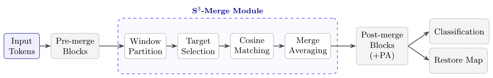

# S³-Merge: Spatially-Restricted Single-Shot Token Merging for Efficient Vision Transformers

> Training-free token merging that replaces per-layer global matching with **one late,
> spatially windowed merge**, converting token reduction into **measured wall-clock
> acceleration** while preserving the 2D layout that dense prediction requires.

<p align="center">
  
</p>

Public repository: https://github.com/fekhrkeddous-cyber/s3-merge

---

## Method overview

**S³-Merge Core** (the complete default method): a single-shot merge at a late
transformer block. Tokens are partitioned into w×w spatial windows; within each
window, K target tokens are selected, sources are assigned to their most-similar
target by hard cosine argmax, and clusters are fused by uniform normalized averaging
(paper Eq. 1). A restore mapping reconstructs the full token grid for dense heads.
Windowing bounds merge displacement by √2(w−1) patches.

**Proportional attention (PA)** is an *optional, task-dependent* correction, not part
of Core: it improves classification by +0.48 Top-1, changes ADE20K by only
+0.02–0.06 mIoU at a 1.2–2.4% throughput cost, and provides no benefit on COCO.
The default dense pipeline therefore runs Core without PA.

**Target selection** is policy-neutral:
- *seeded random Static-K* (historical classification configuration; 79.49 ± 0.03%
  Top-1 over 30 seeds, lowest measured selection cost);
- *deterministic variance-aware Static-K* (recommended for dense prediction);
- *Adaptive-K*: variable per-window keep counts K_w ∈ [K_min, K_max] under an exact
  per-image global budget, fully vectorized, packed no-padding execution with
  exact-coordinate relative positions (`models/adaptive_k.py`).

**Safe Mode** (`models/safemode.py`) is a conservative *empirical* routing policy —
not a guarantee: a one-time calibration sweep measures baseline vs merged latency per
batch size and activates the merged path only where the bootstrap 95% lower confidence
bound of the speedup exceeds 1.02. The result is cached (keyed by model, merge config,
device, driver, precision, resolution, backend), loaded once, and consulted by an
in-memory lookup; unqualified batch sizes fall back to the unmodified baseline.

## Main results (ImageNet-1K, DeiT-S/16, H100 NVL, FP32)

| Method | Top-1 (%) | ΔTop-1 | B=1 (ms) ↓ | B=32 (img/s) ↑ |
|--------|-----------|--------|-------------|-----------------|
| Baseline | 79.71 | — | 2.33 | 2543 |
| ToMe r=10 | 79.09 | −0.62 | 7.32 | 3002 |
| **S³-Merge-Acc (l8+PA)** | **79.50 ± 0.02** | **−0.21** | 2.87 | 2938 |
| S³-Merge-Speed (l6+PA) | 79.01 ± 0.05 | −0.70 | 2.98 | **3306** |

Timings are from the paper's unified FP32 campaign (five invocations, 30 warm-up +
200 timed iterations, per-iteration synchronization); accuracy and timing are
separate evaluations. ToMe r=12 exceeds S³-Merge-Acc at B=32 and leads at B=64;
S³-Merge-Speed leads at B=32 (details in the paper's Section 6.3).

Dense prediction (measured end-to-end framing, no universal-acceleration claim):
- **ViTDet-B / Mask R-CNN (COCO)** is *decoder-bound* (decoder ≈29% of latency):
  Adaptive-K holds full-COCO box AP to −0.09 with a small but statistically robust
  1–2% end-to-end gain — the honest Amdahl ceiling of this pipeline family.
- **LW-DETR-medium (COCO)** is *encoder-dominated* (≈88% of latency at B=8):
  deterministic variance-aware Static-K (K=75/100, merged after the first six encoder
  blocks, wrapper-level integration of the official code) yields a **1.114×
  [1.112, 1.115]** end-to-end speedup at B=8 for −0.46 box AP on full val2017.
- Packed variable-K execution requires a globally compatible post-merge suffix;
  architectures that retain post-merge window attention (e.g., LW-DETR) use the
  deterministic regular per-window Static-K variant instead.

## Installation

```bash
pip install -r requirements.txt          # torch>=2.1, timm>=1.0 recommended
# or, full reproducibility:
docker build -f Dockerfile -t s3merge:cu121 .
docker run --gpus all --shm-size=16g -it -v /path/to/imagenet:/data/imagenet -v $PWD:/workspace s3merge:cu121
```

Baselines (optional): ToMe `pip install git+https://github.com/facebookresearch/ToMe.git`;
PiToMe `git clone https://github.com/hchautran/PiToMe.git baselines/PiToMe`
(commit 550b5dee used in the paper); ATC `git clone https://github.com/JoakimHaurum/ATC.git baselines/ATC`;
DSM is a labelled re-implementation (`baselines/dsm_impl.py`) — no public official
implementation of the published method was identified. See `baselines/README.md`.

## Quick start (classification)

```python
import timm, torch
from models.sr_tome import apply_patch

model = timm.create_model("deit_small_patch16_224", pretrained=True).cuda().eval()
apply_patch(model, target_tokens=84, late_start=8, window_size=7, prop_attn=True)  # S³-Merge-Acc
x = torch.randn(8, 3, 224, 224, device="cuda")
with torch.no_grad():
    y = model(x)
```

Adaptive-K / variance-aware Static-K (grid features, packed execution):

```python
import torch
from models.adaptive_k import PackGeometry, allocate_slot_auction, allocate_uniform, \
    window_scores, adaptive_merge_pack, unpack_restore

x = torch.randn(2, 64, 56, 384, device="cuda")          # (B, H, W, C) feature grid
geom = PackGeometry.get(64, 56, 8, x.device)             # 8x8 merge windows
win = x.view(2, geom.nWh, 8, geom.nWw, 8, 384).permute(0,1,3,2,4,5).reshape(2, geom.n_windows, 64, 384)
_, s_w = window_scores(win)
K_w = allocate_slot_auction(s_w, K_min=32, K_max=64, T_g=3136)   # Adaptive-K, exact budget
# K_w = allocate_uniform(s_w, 56, 56, geom.n_windows*56)         # variance-aware Static-K
packed, coords, restore_idx, stats = adaptive_merge_pack(x, geom, K_w)   # Eq. 1 semantics
full = unpack_restore(packed, restore_idx, 64, 56)                        # dense restore
```

Safe Mode: `python models/safemode.py --validate` runs one cold calibration and prints
the per-batch decisions and B*; the JSON cache is then consulted in-memory at dispatch.

## Dense-prediction integration

Two execution paths are distinguished:
1. **Regular-grid compatibility path (Static-K)** — merged tokens are re-formed into a
   smaller regular grid so window attention keeps working (`eval_coco_vitdet.py`,
   `models/sr_tome_downstream.py`); relative positions are interpolated to the grid.
2. **Packed exact-coordinate path** — packed no-padding sequences with original-grid
   coordinates for relative positions (`models/adaptive_k.py`); requires every
   post-merge block to be global-attention compatible. Adaptive-K runs exclusively
   on this path.

## Reproducibility and timing protocol

The paper's timing protocol: 30 warm-up + 200 timed iterations, per-iteration
`torch.cuda.synchronize()`, five independent process invocations, paired-bootstrap
95% confidence intervals; FP32 on datacenter GPUs (ViT-B/16 rows use AMP/FP16 as
labelled). Some historical scripts in this repository use their own documented
iteration counts (see `EXPERIMENTS.md`); classification accuracy protocols use the
full 50k ImageNet-1K validation set in canonical order with per-seed
`torch.manual_seed`/`np.random.seed`. Evaluated scope: DeiT-S/B, ViT-B/L, DINOv2-L,
SigLIP-L (classification); UPerNet-ADE20K, ViTDet-COCO, LW-DETR-COCO (dense);
H100, L40S, Jetson Orin (deployment). Claims are restricted to this scope.

## Limitations / architecture compatibility

- `apply_patch` targets timm-style ViTs (a `model.blocks` list, CLS token); the window
  size must divide the patch grid (non-divisible grids are a no-op by design).
- PA requires a timm version whose `Block.forward` accepts `attn_mask`.
- Packed variable-K needs a globally compatible post-merge suffix (see above).
- Safe Mode is an empirical routing policy calibrated per device/configuration;
  it provides no formal guarantee.
- HF DINOv2/SigLIP classification requires the small `encoder.forward` adapter
  described in `EXPERIMENTS.md`.

## Citation

Paper under double-blind review at a journal (second-round revision). A BibTeX entry
will be added upon acceptance.

## License

MIT (see `LICENSE`).
